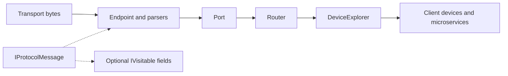

# Asv.IO

`Asv.IO` separates byte transport, protocol decoding, message processing, and logical devices. An application can use the same connection contracts with different protocols without depending on concrete packet classes or transport implementations.

This section follows the architectural guides for [Asv.Modeling](Asv-Modeling.md): contracts first, then data flow, ownership, and short examples. The current source and tests are authoritative for exact behavior.

## Layers



The receive path above describes aggregation. Sending goes from a chosen connection toward its endpoints. A parser recognizes protocol messages; a device factory identifies logical devices from those messages. These are separate responsibilities.

| Area | Main contracts | Guide |
| --- | --- | --- |
| Construction and decoding | `IProtocolFactory`, `IProtocolBuilder`, `IProtocolParser` | [Protocols](IO-Protocols.md) |
| Transport and aggregation | `IProtocolConnection`, `IProtocolRouter`, `IProtocolPort`, `IProtocolEndpoint` | [Connections](IO-Connections.md) |
| Processing and formatting | `IProtocolFeature`, `IProtocolMessageFormatter` | [Features and formatters](IO-Features.md) |
| Binary representation | `ISpanSerializable`, `ISizedSpanSerializable`, `IProtocolMessage` | [Serialization](IO-Serialization.md) |
| Structured field access | `IVisitable`, `IVisitor`, `Field`, `IFieldType` | [Fields and visitors](IO-Visitors.md) |
| Device identity and lifecycle | `IDeviceExplorer`, `IClientDeviceFactory`, `IClientDevice` | [Devices](IO-Devices.md) |

## A Hardware-Free Exchange

The example protocol is included in the package and can be used with a virtual connection. This exchange does not open network or serial ports.

```csharp
using Asv.IO;
using R3;

var factory = Protocol.Create(builder =>
{
    builder.Protocols.RegisterExampleProtocol();
});

await using var link = factory.CreateVirtualConnection(printMessagesToLog: false);
using var subscription = link.Client.OnRxMessage.Subscribe(message =>
{
    Console.WriteLine($"{message.Protocol.Name}: {message.Name}");
});

await link.Server.Send(new ExampleMessage2
{
    SenderId = 1,
    Value1 = 42,
    Value3 = "Virtual exchange",
    Value5 = 12.5f,
});
```

A virtual connection has client and server sides. It serializes and parses messages between those sides, so it is useful for checking more than a direct object callback. Transport-specific behavior, reconnects, and queueing still require separate validation.

## Boundaries To Keep Explicit

- An endpoint identifies a transport connection. It does not necessarily identify one logical device.
- A message name or message ID identifies a message kind, not its sender.
- `IProtocolMessage` guarantees serialization and basic identity; it does not require `IVisitable` or a device identifier.
- A connection's TX event is local to that connection level. Router TX and endpoint TX do not describe the same stage.
- `IDeviceExplorer.TryIdentify` determines identity without creating, updating, or keeping a device alive.

## Source Map

The main implementation areas are `src/Asv.IO/Protocol`, `src/Asv.IO/Serializable`, `src/Asv.IO/Visitable`, and `src/Asv.IO/Devices`. Executable examples live in `src/Asv.IO/Example`; matching tests are under `src/Asv.IO.Test`.
