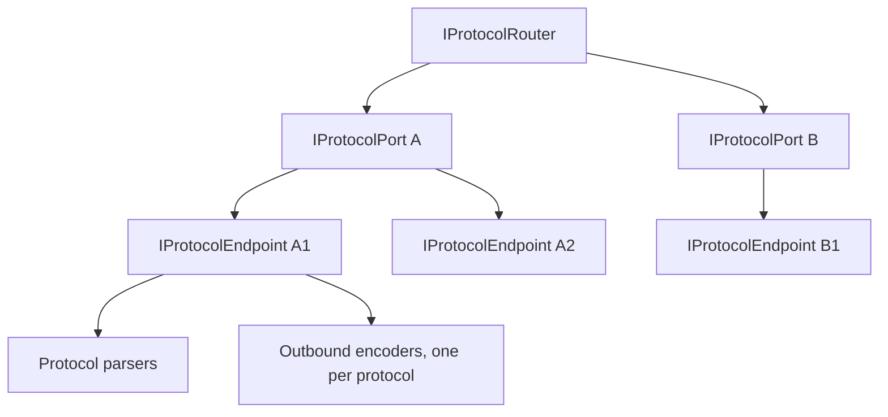
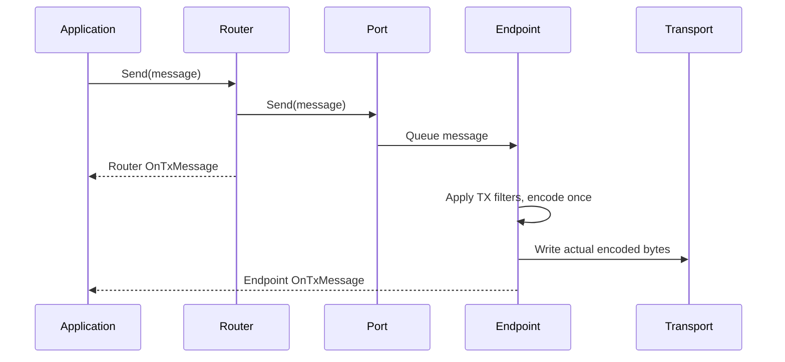

# Connections

`IProtocolConnection` is the common message-oriented contract for routers, ports, and endpoints. It exposes RX/TX messages, RX/TX errors, statistics, tags, formatting, and `Send`.

## Topology



| Level | Responsibility | Topology notifications |
| --- | --- | --- |
| Router | Aggregates ports and sends through its current port set. | `PortAdded`, `PortRemoved`, `PortUpdated` |
| Port | Configures a transport, manages endpoints, and exposes enabled/status/error state. | `EndpointAdded`, `EndpointRemoved` |
| Endpoint | Performs transport I/O, parsing, and outbound encoding for one connection. | Owned by the port; exposes parsers, `LastError`, and disposal state. |

A server port can have several endpoints. One endpoint can carry messages from several logical devices. Keep the pair of port ID and endpoint ID when recording an observation; do not infer device identity from endpoint identity alone.

## Transport Selection

`router.AddPort(...)` selects a registered transport factory by URI scheme.

| Scheme | Transport |
| --- | --- |
| `tcp` | TCP client |
| `tcps` | TCP server; this scheme does not mean TLS. |
| `udp` | UDP |
| `serial` | Serial port |

`ProtocolPortConfig` exposes common options such as `Name`, `IsEnabled`, and enabled protocols. Concrete transport configurations add their own options. Read the relevant configuration class before constructing a URI with additional options.

## RX And TX Are Level-Specific



The diagram shows different observation stages, not a guaranteed scheduling order between the router callback and the endpoint write loop. Router TX indicates completion of router-level sending to ports. A physical endpoint publishes TX after its write operation; it is still not a remote acknowledgement.

RX aggregation flows from endpoint to port to router. Built-in connections await an internal forwarding handler at each level, including asynchronous RX features, so a slow parent can apply backpressure to the endpoint reader. Public `OnRxMessage` observations remain available at each level. Observing every level without recording the level produces duplicate-looking observations of the same message.

## Observe A Known Endpoint

```csharp
using Asv.IO;
using R3;

static IDisposable ObserveEndpoint(IProtocolEndpoint endpoint)
{
    return endpoint.OnRxMessage.Subscribe(message =>
    {
        Console.WriteLine($"RX {endpoint.Id}: {message.Name}");
    });
}
```

For a topology-wide monitor, maintain one subscription scope per port and per endpoint. Subscribe to topology changes and reconcile the current collections without adding duplicate subscriptions. Dispose endpoint subscriptions immediately on removal; dispose all remaining scopes when the monitor stops.

## Queueing

Physical endpoints use separate receive and transmit channels:

| Option | Behavior |
| --- | --- |
| `rx_queue` / `RxQueueSize` | Receive capacity; defaults to 100. |
| `tx_queue` / `TxQueueSize` | Transmit capacity; defaults to 100. |
| `rx_drop` / `DropMessageWhenFullRxQueue` | When `true`, discard the oldest queued RX message to accept the newest. Defaults to `false`, which waits for space. |
| `tx_drop` / `DropMessageWhenFullTxQueue` | The corresponding TX policy. |
| Queue capacity at or below zero | Explicitly selects an unbounded channel. |

An explicit `rx_queue` is independent of `tx_queue`. For compatibility, an existing URI that specifies only `tx_queue` continues to use that value for both capacities. Setting `RxQueueSize` writes the separate `rx_queue` option.

Parser `Push` and message emission are synchronous. With the RX wait policy, the read loop holds at most one parsed message awaiting channel space before supplying another input byte. In addition to the configured queue, one message can be in publication and one in that handoff. A parser that emits another message while the handoff is occupied fails the endpoint instead of creating an unbounded backlog.

The protected synchronous `InternalPublishRxMessage` entry point remains available to existing derived connections and is used by the virtual port. It processes one publication at a time with a FIFO of up to 100 waiting messages. If that queue is full, the incoming message is dropped and the RX drop statistic increases. This fallback cannot pause its synchronous producer; its drop-newest policy is separate from the physical endpoint channel settings.

Awaiting `Send` at an aggregate level completes forwarding to endpoint queues. It does not establish successful delivery to a remote application.

The physical endpoint's single-reader transmit loop applies TX filters before selecting an encoder and encoding the resulting message. Messages dropped from the queue or rejected by a filter do not advance encoder state. Each endpoint retains a separate encoder per protocol, so sending the same message through multiple endpoints keeps each outbound stream independent. Routers and ports forward message objects without sharing a stateful encoder between endpoints.

Only the actual encoded bytes are sent and counted in TX statistics. TCP endpoints pass the complete frame to `Socket.SendAsync`. If a transport reports an incomplete write or fails, the endpoint reports the error, completes its channels, and cancels its loops. It does not roll back encoding or automatically resend a possibly partial frame. A replacement endpoint starts with fresh encoder instances.

Virtual ports also honor the actual encoded length. A semaphore serializes filtering, encoding, and delivery to the virtual byte stream, keeping encoder state changes in the same order as the emitted frames. An encoding or delivery error is reported through TX errors and `LastError`; subsequent sends do not continue that failed virtual stream.

Direct `IDataStream` and `Stream` encoding helpers have no endpoint queue. Their caller owns synchronization and must serialize the complete encode-and-send operation when sharing a stateful encoder. See [Serialization](IO-Serialization.md) for explicit helpers and buffer lifetime requirements.

## Startup And Disposal

Built-in serial, TCP, and UDP endpoints initialize their transport state before starting read, write, and RX publication loops. Custom subclasses can use the protected `ProtocolEndpoint` constructor overload with `startImmediately: false`, initialize their fields, and call `Start()` at the end of construction. The existing constructor retains immediate startup for compatibility.

Endpoint disposal cancels transport operations and queue waits immediately. Synchronous `Dispose()` starts tracked cleanup and returns without waiting for all loops. The endpoint returns temporary buffers, disposes its parser subscriptions and owned parsers, releases queued messages, and clears encoder references after its loops exit. `DisposeAsync()` waits for this cleanup when it is the first disposal call. Disposal is once-only: calling `DisposeAsync()` after `Dispose()` does not provide a second wait for completion.

Asynchronous RX and TX feature waits also end when their connection is disposed. Features should still honor their supplied cancellation token: stopping the wait cannot terminate a feature's own work if it ignores cancellation. Virtual ports serialize parser access and defer parser disposal until an active synchronous read exits; a callback can call `Dispose()` without returning a parser's buffer while `Push` is still using it.

Removing a port through the router disposes that port. A monitor observes these lifetimes; it must not dispose shared ports or endpoints just because an inspection page closes. Messages are mutable objects, so copy values needed for history instead of retaining a supposedly frozen live reference.

## Transport-Specific Lifetimes

UDP endpoints ignore empty datagrams. Cancellation or disposal releases the shared receive producer if it is waiting for an endpoint to consume a datagram. A failed serial endpoint construction releases the parsers it was given.

The legacy `TcpServerPort` byte stream has a per-recipient forwarding FIFO of 100 frames. Queued frames own a byte copy so the receive buffer can be reused. Forwarding does not wait for a slow peer; a full forwarding queue disconnects that peer. An explicit `Send` awaits the queued socket write. A graceful remote close removes and disposes the client, and asynchronous server disposal waits for receive, accept, and writer shutdown.

Text and Telnet sends and JSON requests are cancelled when their owning wrapper is disposed. Telnet exposes received text through `OnReceive`, and completion of a text stream ends a pending `RequestText` wait.

## Source Files

- `src/Asv.IO/Protocol/Connection/IProtocolConnection.cs`.
- `src/Asv.IO/Protocol/Connection/Router/ProtocolRouter.cs`.
- `src/Asv.IO/Protocol/Connection/Port/ProtocolPort.cs`.
- `src/Asv.IO/Protocol/Connection/Endpoint/ProtocolEndpoint.cs`.
- `src/Asv.IO/Protocol/Connection/Virtual/VirtualPort.cs`.
- `src/Asv.IO/Streams/Ports/Tcp/TcpServerPort.cs`.

See [Devices](IO-Devices.md) for logical identity and [Features and formatters](IO-Features.md) for processing stages.
