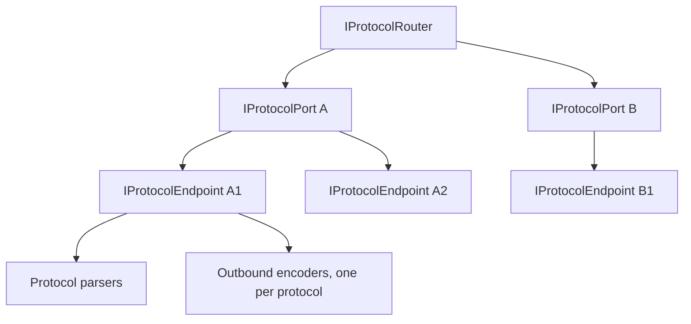
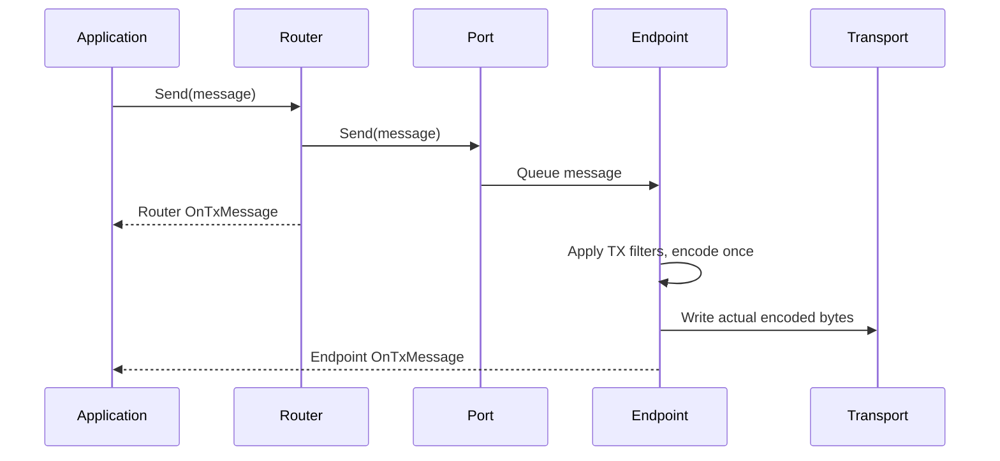

# Connections

`IProtocolConnection` is the common message-oriented contract for routers, ports, and endpoints. It exposes RX/TX messages, RX/TX errors, statistics, tags, formatting, and `Send`.

## Topology



| Level | Responsibility | Topology notifications |
| --- | --- | --- |
| Router | Aggregates ports and sends through its current port set. | `PortAdded`, `PortRemoved`, `PortUpdated` |
| Port | Configures a transport, manages endpoints, and exposes enabled/status/error state. | `EndpointAdded`, `EndpointRemoved` |
| Endpoint | Performs transport I/O, parsing, and outbound encoding for one connection. | Owned by the port; exposes parsers, `LastError`, and disposal state. |

A server port can have several endpoints. One endpoint can carry messages from several logical devices. Keep the pair of port ID and endpoint ID when recording an observation; do not infer device identity from endpoint identity alone.

## Transport Selection

`router.AddPort(...)` selects a registered transport factory by URI scheme.

| Scheme | Transport |
| --- | --- |
| `tcp` | TCP client |
| `tcps` | TCP server; this scheme does not mean TLS. |
| `udp` | UDP |
| `serial` | Serial port |

`ProtocolPortConfig` exposes common options such as `Name`, `IsEnabled`, and enabled protocols. Concrete transport configurations add their own options. Read the relevant configuration class before constructing a URI with additional options.

## RX And TX Are Level-Specific



The diagram shows different observation stages, not a guaranteed scheduling order between the router callback and the endpoint write loop. Router TX indicates completion of router-level sending to ports. A physical endpoint publishes TX after its write operation; it is still not a remote acknowledgement.

RX aggregation flows from endpoint to port to router. Observing every level without recording the level produces duplicate-looking observations of the same message.

## Observe A Known Endpoint

```csharp
using Asv.IO;
using R3;

static IDisposable ObserveEndpoint(IProtocolEndpoint endpoint)
{
    return endpoint.OnRxMessage.Subscribe(message =>
    {
        Console.WriteLine($"RX {endpoint.Id}: {message.Name}");
    });
}
```

For a topology-wide monitor, maintain one subscription scope per port and per endpoint. Subscribe to topology changes and reconcile the current collections without adding duplicate subscriptions. Dispose endpoint subscriptions immediately on removal; dispose all remaining scopes when the monitor stops.

## Queueing And Lifetime

Physical endpoints use receive and transmit channels. Queue size and drop/wait behavior are configured through the port configuration. Awaiting `Send` at an aggregate level does not establish successful delivery to a remote application.

The physical endpoint's single-reader transmit loop applies TX filters before selecting an encoder and encoding the resulting message. Messages dropped from the queue or rejected by a filter do not advance encoder state. Each endpoint retains a separate encoder per protocol, so sending the same message through multiple endpoints keeps each outbound stream independent. Routers and ports forward message objects without sharing a stateful encoder between endpoints.

Only the actual encoded bytes are sent and counted in TX statistics. TCP endpoints pass the complete frame to `Socket.SendAsync`; the .NET runtime handles underlying partial sends for the TCP sockets created by these ports. An incomplete or failed transport write stops that endpoint's write loop; it does not roll back encoding or automatically resend a possibly partial frame. A replacement endpoint starts with fresh encoder instances.

Virtual ports also honor the actual encoded length. A semaphore serializes filtering, encoding, and delivery to the virtual byte stream, keeping encoder state changes in the same order as the emitted frames. An encoding or delivery error is reported through TX errors and `LastError`; subsequent sends do not continue that failed virtual stream.

Direct `IDataStream` and `Stream` encoding helpers have no endpoint queue. Their caller owns synchronization and must serialize the complete encode-and-send operation when sharing a stateful encoder. See [Serialization](IO-Serialization.md) for explicit helpers and buffer lifetime requirements.

Removing a port through the router disposes that port. A monitor observes these lifetimes; it must not dispose shared ports or endpoints just because an inspection page closes. Messages are mutable objects, so copy values needed for history instead of retaining a supposedly frozen live reference.

## Source Files

- `src/Asv.IO/Protocol/Connection/IProtocolConnection.cs`.
- `src/Asv.IO/Protocol/Connection/Router/ProtocolRouter.cs`.
- `src/Asv.IO/Protocol/Connection/Port/ProtocolPort.cs`.
- `src/Asv.IO/Protocol/Connection/Endpoint/ProtocolEndpoint.cs`.
- `src/Asv.IO/Protocol/Connection/Virtual/VirtualPort.cs`.

See [Devices](IO-Devices.md) for logical identity and [Features and formatters](IO-Features.md) for processing stages.
