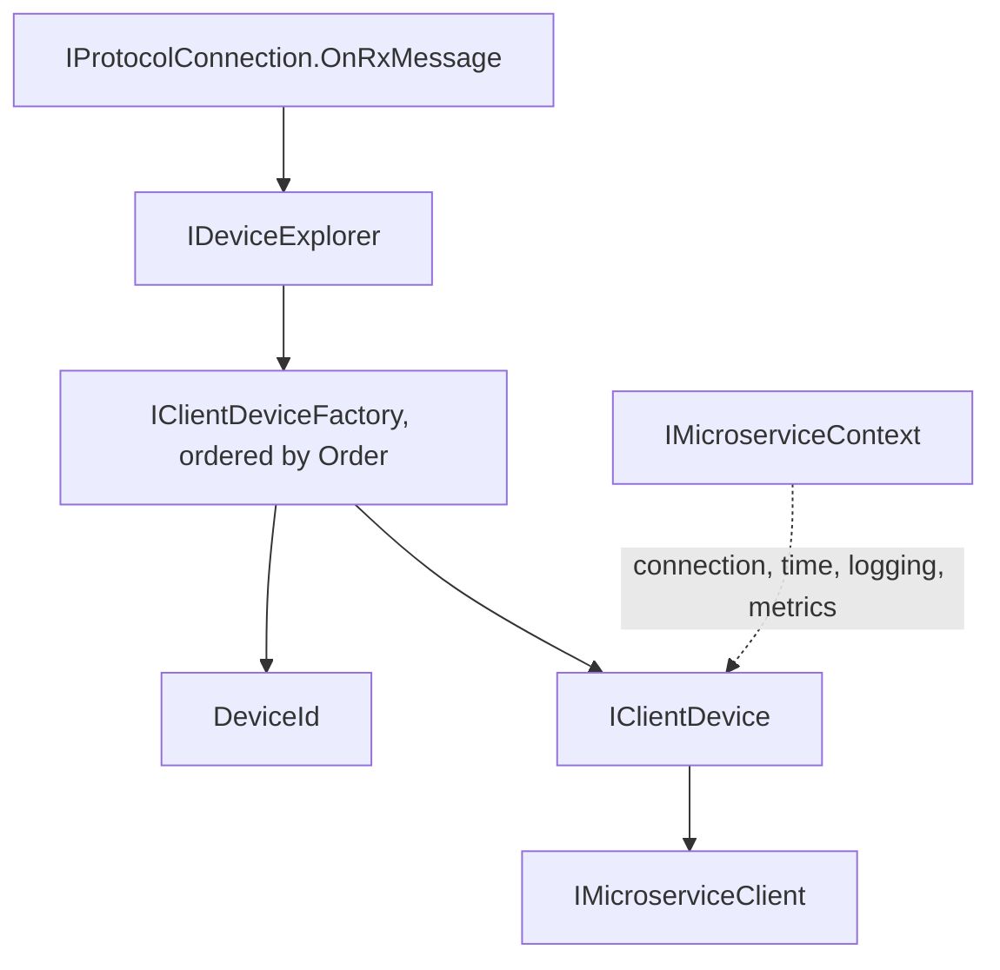
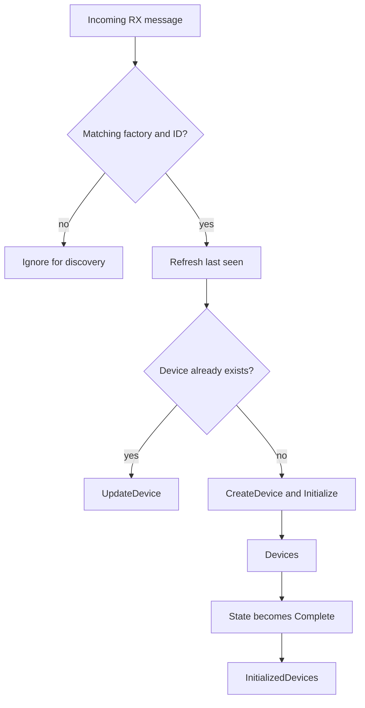

# Devices And Identification

The device layer turns a protocol message stream into logical devices and microservices. Identity is provided by registered factories; neither endpoint addresses nor concrete protocol headers are assumed by the shared explorer.

## Core Contracts



| Contract | Responsibility |
| --- | --- |
| `DeviceId` | Represents a protocol-specific logical device identity and its string form. |
| `DeviceAddress` | Represents a canonical source address as an ordinal protocol-family/value pair, independent of the transport channel. |
| `IClientDeviceFactory` | Identifies discovery messages, creates and updates devices, and optionally extracts source and device addresses. |
| `IDeviceExplorer` | Observes discovery traffic, exposes discovered and initialized devices, and resolves message sources to live devices. |
| `IClientDevice` | Exposes identity, name, initialization state, link state, and microservices. |
| `IClientDeviceExtender` | Contributes device-specific extensions through the configured lifecycle. |
| `IMicroserviceContext` | Supplies connection, logger factory, time provider, and metrics. |

## Register Factories

```c#
using System;
using System.Globalization;
using Asv.IO;
using Asv.IO.Device;

var factory = Protocol.Create(builder =>
{
    builder.Protocols.RegisterExampleProtocol();
});
await using var link = factory.CreateVirtualConnection(printMessagesToLog: false);
await using var explorer = DeviceExplorer.Create(link.Client, builder =>
{
    builder.Factories.Register(new AddressedExampleFactory());
});

var telemetry = new ExampleMessage2 { SenderId = 7 };
if (explorer.TryGetSourceAddress(telemetry, out var sourceAddress))
{
    Console.WriteLine($"{sourceAddress.Family}/{sourceAddress.Value}"); // example/7, before discovery.
}
var offlineId = new ExampleDeviceId(ExampleDevice.DeviceClass, 7);
Console.WriteLine(explorer.TryGetDeviceAddress(offlineId, out _)); // True: pure ID extraction.
Console.WriteLine(explorer.TryIdentify(telemetry, out _)); // False: not discovered yet.
await link.Server.Send(new ExampleMessage1 { SenderId = 7 });
if (explorer.TryIdentify(telemetry, out var deviceId))
{
    Console.WriteLine(deviceId.AsString());
}

sealed class AddressedExampleFactory() : ExampleDeviceFactory(new ExampleDeviceConfig())
{
    protected override bool InternalTryIdentify(ExampleMessageBase message, out ExampleDeviceId? deviceId)
    {
        if (message is ExampleMessage1)
        {
            return base.InternalTryIdentify(message, out deviceId);
        }
        deviceId = null;
        return false;
    }

    public override bool TryGetSourceAddress(IProtocolMessage message, out DeviceAddress address)
    {
        if (message is ExampleMessageBase example)
        {
            address = new DeviceAddress("example", example.SenderId.ToString(CultureInfo.InvariantCulture));
            return true;
        }
        address = default;
        return false;
    }

    public override bool TryGetDeviceAddress(DeviceId deviceId, out DeviceAddress address)
    {
        if (deviceId is ExampleDeviceId example)
        {
            address = new DeviceAddress("example", example.TargetId.ToString(CultureInfo.InvariantCulture));
            return true;
        }
        address = default;
        return false;
    }
}
```

The explorer snapshots the registered factories and orders them by ascending `Order`. It selects the first factory that returns `true` with a non-null ID. A rejected factory does not prevent later factories from matching.

Address support is optional: both address methods return `false` by default on the interface and generic factory base. Existing factories keep their discovery behavior. The example adds address support in a derived factory and limits discovery to `ExampleMessage1`, while messages such as `ExampleMessage2` can still identify the source of an already discovered device.

## Discovery And Initialization



`Devices` includes discovered devices. `InitializedDevices` adds each device on its first `Complete` notification and removes it when the device is removed from `Devices`; it does not continuously filter the current initialization or link state. Initialization and link connectivity are distinct concepts, so inspect the relevant state when readiness matters.

The timeout timer removes inactive devices according to `ClientDeviceBrowserConfig.DeviceTimeoutMs` and `DeviceCheckIntervalMs`. Elapsed time and timer scheduling use the explorer's `TimeProvider`. Configure it with `IDeviceExplorerBuilder.SetTimeProvider`; the builder defaults independently to `TimeProvider.System`, even if the connection uses another provider. Dispose the explorer to stop discovery subscriptions, its timer, and its owned devices and clear both device collections; dispose the connection through its own owner.

When discovery supplies an address, the explorer reuses the existing device for that canonical address across channels and local identities. The factory that created the device performs these address-deduplicated updates. Discovery without a usable address preserves identity-based updates through the currently matching discovery factory. Address bindings become available with `Devices`, before initialization completes, and are removed on timeout or disposal. Distinct remote addresses remain separate even when their `DeviceId` values share a device class or hash code. The public `DeviceId` equality contract is unchanged; Explorer uses derived object equality internally. A late `Complete` notification can only add the same still-registered instance while Explorer is active; it cannot restore a removed device or repopulate the initialized list after disposal.

`ClientDevice<TDeviceId>.Initialize()` starts initialization without returning an awaitable completion. Repeated calls are ignored after initialization has started successfully; they do not create another microservice generation. An initialization failure in the asynchronous attempt sets `Failed` and schedules another attempt through `Context.TimeProvider` after `ClientDeviceConfig.RequestDelayAfterFailMs`. Observe `State` to track completion.

## Requests And Periodic Sending

`MicroserviceBase<TBaseMessage>` request helpers subscribe for a matching response before sending. Each attempt owns a timeout source using `Context.TimeProvider` and links it to caller cancellation and the microservice's disposal token. The subscription, linked source, and timeout source are disposed when the attempt finishes, including an early response.

`InternalCall` uses `timeoutMs` per attempt and `attemptCount` as the total number of attempts. Exhausted response timeouts produce `TimeoutException`; caller cancellation and microservice disposal stop retries. The public connection `SendAndWaitAnswer` timeout overloads accept their own optional `TimeProvider`, defaulting to `TimeProvider.System`. These helpers do not automatically link response waiting to connection disposal; supply a caller lifetime token for that scope.

`WaitUntilConnect` waits for link connectivity. `WaitUntilConnectAndInit` then waits for initialization with a new timeout scope: its `timeoutMs` applies separately to each phase, rather than as one total deadline. Both helpers use the supplied provider and release their timeout sources and subscriptions on completion.

`ProtocolMessageTransponder<TMessage>` uses its supplied provider for periodic sends. Starting it again replaces its timer. If a previous send is still running, the next tick is skipped instead of queued. `Set` serializes message updates with sending, so it can block until an active send finishes; do not call it from the per-send callback. `Stop` prevents future ticks but does not cancel a send already in progress. Disposal cancels the active send; first-call `DisposeAsync` also awaits its completion before releasing resources, while `Dispose` defers that cleanup.

## Identity Is Optional Per Message

`IDeviceExplorer.TryGetSourceAddress(message, out address)` and `TryGetDeviceAddress(deviceId, out address)` expose pure address extraction through the ordered factory snapshot. They work before discovery, without requiring an existing device, and remain available after Explorer disposal. Both select the first valid successful factory result, return `false` with a default address for unsupported input, and throw `ArgumentNullException` for null input. Neither method calls discovery, creates or updates a device, or refreshes last seen. These methods also have compatible false defaults on `IDeviceExplorer` for existing external implementations.

`IDeviceExplorer.TryIdentify(message, out deviceId)` is a read-only source lookup. The first registered factory in `Order` that extracts a valid source address supplies the canonical address. Lookup returns `true` only if that address currently belongs to a discovered device; it returns `false` and a null ID before discovery, for unknown or unsupported messages, after removal, and after explorer disposal. A null message throws `ArgumentNullException`. Lookup does not call factory discovery, create a device, invoke an update, or refresh the timeout.

`TryGetSourceAddress` may accept more packet types than discovery does. `TryGetDeviceAddress` derives the same canonical address from the discovered ID and provides a discovery fallback when no source extractor accepts that message. If both hooks provide conflicting addresses, the explorer logs the conflict and retains ordinary discovery without creating an address binding. `DeviceAddress` requires nonblank strings, compares them ordinally, and does not normalize them; the factory must produce a consistent family and value. The default struct value is invalid and cannot be bound.

Keep an explicit unidentified category when a message has no live source identity. Do not assign the most recently seen device on an endpoint to every subsequent message: multiple devices can share a transport connection. Source attribution does not resolve a TX destination, and an extracted address alone does not establish device discovery or readiness.

The shared layer has no mandatory system/component fields or protocol-specific addressing. A device factory supplies the meaning of `DeviceId` for its protocol.

## Source Files And Tests

- `src/Asv.IO/Devices/Explorer/IDeviceExplorer.cs` and `DeviceExplorer.cs`.
- `src/Asv.IO/Devices/Explorer/Factories/IClientDeviceFactory.cs`.
- `src/Asv.IO/Devices/Client/IClientDevice.cs`, `DeviceId.cs`, and `DeviceAddress.cs`.
- `src/Asv.IO/Devices/Client/ClientDevice.cs`, `Devices/MicroserviceBase.cs`, and `Protocol/ProtocolHelper.cs`.
- `src/Asv.IO/Protocol/Tools/ProtocolMessageTransponder.cs`.
- `src/Asv.IO.Test/Devices/Explorer/DeviceExplorerTest.cs`, including `DeviceList_CreateAndRemoveDevices_Success`.
- `src/Asv.IO.Test/Devices/Explorer/DeviceAddressExplorerTest.cs` covers live source lookup, address deduplication, factory ownership, collisions, and address lifecycle.
- `src/Asv.IO.Test/Devices/DeviceLifetimeRegressionTest.cs`, `ProtocolRequestLifetimeTest.cs`, and `Protocol/Tools/ProtocolMessageTransponderLifetimeTest.cs`.

See [Connections](IO-Connections.md) for transport identity and [Fields and visitors](IO-Visitors.md) for protocol-independent field inspection.
