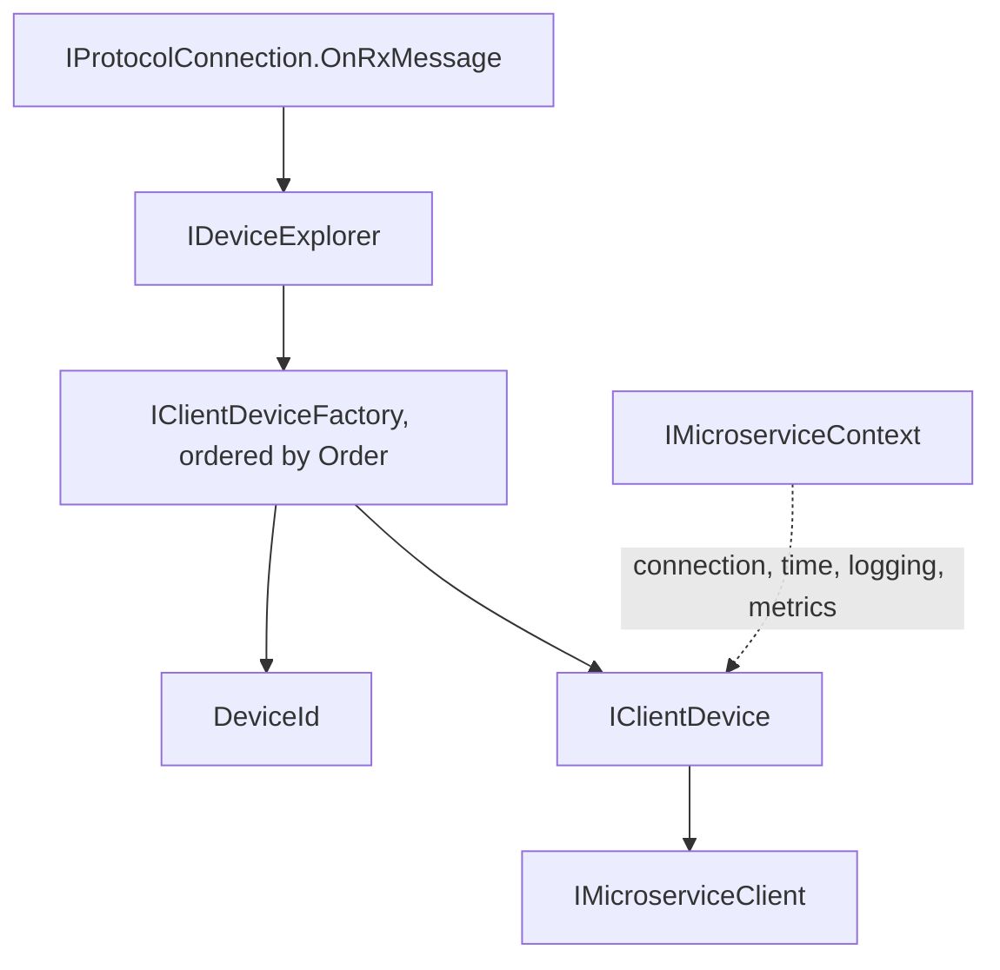
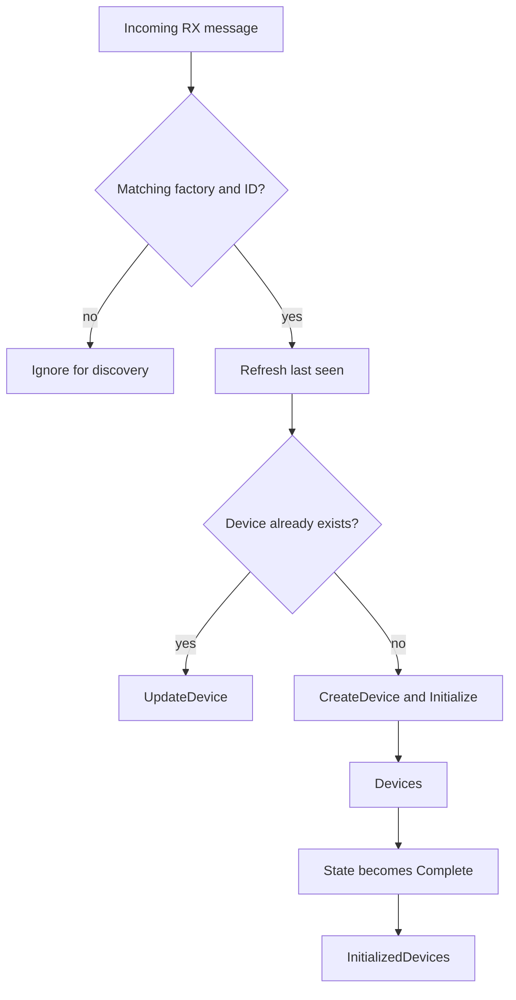

# Devices And Identification

The device layer turns a protocol message stream into logical devices and microservices. Identity is provided by registered factories; neither endpoint addresses nor concrete protocol headers are assumed by the shared explorer.

## Core Contracts



| Contract | Responsibility |
| --- | --- |
| `DeviceId` | Represents a protocol-specific logical device identity and its string form. |
| `IClientDeviceFactory` | Identifies messages, creates devices, and updates existing devices. |
| `IDeviceExplorer` | Observes discovery traffic, exposes devices, and offers identity-only lookup. |
| `IClientDevice` | Exposes identity, name, initialization state, link state, and microservices. |
| `IClientDeviceExtender` | Contributes device-specific extensions through the configured lifecycle. |
| `IMicroserviceContext` | Supplies connection, logger factory, time provider, and metrics. |

## Register Factories

```csharp
using Asv.IO;
using Asv.IO.Device;

var factory = Protocol.Create(builder =>
{
    builder.Protocols.RegisterExampleProtocol();
});
await using var link = factory.CreateVirtualConnection(printMessagesToLog: false);
await using var explorer = DeviceExplorer.Create(link.Client, builder =>
{
    builder.Factories.RegisterExampleDevice(new ExampleDeviceConfig());
});

var message = new ExampleMessage1 { SenderId = 7 };
if (explorer.TryIdentify(message, out var deviceId))
{
    Console.WriteLine(deviceId.AsString());
}
Console.WriteLine(explorer.Devices.Count); // 0: identification did not discover a device.
```

The explorer snapshots the registered factories and orders them by ascending `Order`. It selects the first factory that returns `true` with a non-null ID. A rejected factory does not prevent later factories from matching.

## Identification Without Discovery

`IDeviceExplorer.TryIdentify(IProtocolMessage message, out DeviceId? deviceId)` uses the same factory selection as discovery, but stops after identification.

| Operation | `TryIdentify` | Incoming discovery message |
| --- | --- | --- |
| Select a factory and determine `DeviceId` | Yes | Yes |
| Create and initialize a new device | No | When the ID is new |
| Call `UpdateDevice` for an existing device | No | Yes |
| Refresh the last-seen timestamp | No | Yes |
| Add a device to `Devices` | No | When a new device is created |

On success, the nullable annotation guarantees a non-null output. On no match, the method returns `false` and sets the output to `null`. A null input is rejected. Factory exceptions are not converted to an unidentified result by the explorer; callers that need a resilient inspection boundary should handle them there.

Factories should keep `TryIdentify` limited to identity extraction. The explorer does not call `CreateDevice` or `UpdateDevice` during identity-only lookup, but it cannot prevent side effects inside a factory's identification implementation.

This method is useful for packet inspectors and filters: traffic can be classified without creating live devices or preventing inactive devices from timing out. An application-level device manager can delegate to the explorer rather than maintain a second registry of factories.

## Discovery And Initialization



`Devices` includes discovered devices; `InitializedDevices` tracks initialized devices according to their state notifications. Initialization and link connectivity are distinct concepts, so use the relevant state instead of assuming that being present in the explorer means a device is ready.

The timeout timer removes inactive devices according to `ClientDeviceBrowserConfig.DeviceTimeoutMs` and `DeviceCheckIntervalMs`. `TryIdentify` does not refresh those timers. Dispose the explorer to stop discovery subscriptions, its timer, and its owned devices; dispose the connection through its own owner.

## Identity Is Optional Per Message

A registered factory may recognize some message kinds and reject others. Keep an explicit unidentified category when a message has no device identity. Do not assign the most recently seen device on an endpoint to every subsequent message: multiple devices can share a transport connection.

The shared layer has no mandatory system/component fields or protocol-specific addressing. A device factory supplies the meaning of `DeviceId` for its protocol.

## Source Files And Tests

- `src/Asv.IO/Devices/Explorer/IDeviceExplorer.cs` and `DeviceExplorer.cs`.
- `src/Asv.IO/Devices/Explorer/Factories/IClientDeviceFactory.cs`.
- `src/Asv.IO/Devices/Client/IClientDevice.cs` and `DeviceId.cs`.
- `src/Asv.IO.Test/Devices/Explorer/DeviceExplorerTest.cs`, including `TryIdentify_KnownMessage_DoesNotCreateDevice`, `TryIdentify_FactoriesRegisteredOutOfOrder_UsesFirstMatchingPriority`, and `TryIdentify_ExistingDevice_DoesNotRefreshLastSeen`.

See [Connections](IO-Connections.md) for transport identity and [Fields and visitors](IO-Visitors.md) for protocol-independent field inspection.
