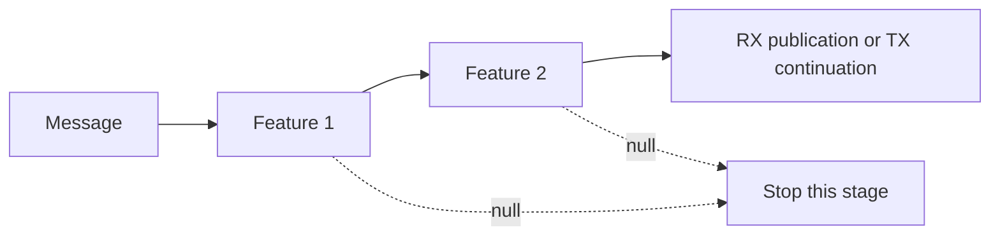

# Features And Formatters

Features participate in message processing. Formatters provide text representations. Neither contract requires the application to understand a concrete protocol packet type.

## Feature Contract

| Member | Responsibility |
| --- | --- |
| `Id`, `Name`, `Description` | Identifies and describes the feature. |
| `Priority` | Exposes priority metadata; the current builder does not sort features by this value. |
| `Register(connection)` | Attaches feature-specific state when a connection is constructed. |
| `Unregister(connection)` | Releases feature-specific state when the connection is disposed. |
| `ProcessRx(message, connection, cancel)` | Processes a received message at that connection level. |
| `ProcessTx(message, connection, cancel)` | Processes a message on its outgoing path. |

The current pipeline runs features in their registration order. A feature returns the original message, a replacement message, or `null` to stop processing that message at the current stage.



Features can run at endpoint, port, and router levels. Check the supplied connection type when behavior belongs to one particular level. A TX feature is a processing hook, not evidence that bytes have already been written.

## Endpoint Identity Tags

`EndpointIdTagFeature` sets an endpoint identity tag on received messages. Register it through the feature builder:

```csharp
using Asv.IO;
using R3;

var factory = Protocol.Create(builder =>
{
    builder.Protocols.RegisterExampleProtocol();
    builder.Features.RegisterEndpointIdTagFeature();
});

await using var link = factory.CreateVirtualConnection(printMessagesToLog: false);
using var subscription = link.Client.OnRxMessage.Subscribe(message =>
{
    Console.WriteLine(message.GetEndpointId());
});
await link.Server.Send(new ExampleMessage3 { SenderId = 1 });
```

The feature currently populates the message tag on RX, not TX. Treat the tag as optional. For an endpoint-level observer, retaining the endpoint from the subscription is a direct way to associate both RX and TX with a connection.

## Broadcasting

`BroadcastingFeature<TMessage>` can retransmit matching incoming messages through the router. It uses connection/message tags and loop-protection state. Use the explicit `BroadcastingFeatureOptions` when configuring loop protection; do not assume a general router broadcasts received traffic automatically.

Broadcasting changes traffic. A passive inspector should normally observe endpoint events rather than implement forwarding as part of its capture logic.

## Formatters

`IProtocolMessageFormatter` declares `CanPrint`, `Print`, and `Order`. The factory sorts registered formatters by `Order`; the protocol formatter selects the first capable formatter. `PacketFormatting` selects inline or indented output.

The built-in simple formatter and JSON formatter are convenient text views. A formatted object is not an exact recording of bytes received on a transport. Re-serializing a message is also different from capturing its original frame, especially when diagnosing damaged or unsupported packets.

## Source Files

- `src/Asv.IO/Protocol/Features/IProtocolFeature.cs`.
- `src/Asv.IO/Protocol/Connection/ProtocolConnection.cs`.
- `src/Asv.IO/Protocol/Features/EndpointIdTag` and `Features/Broadcast`.
- `src/Asv.IO/Protocol/Formatters`.

See [Connections](IO-Connections.md) for event stages and [Serialization](IO-Serialization.md) for binary representation.
