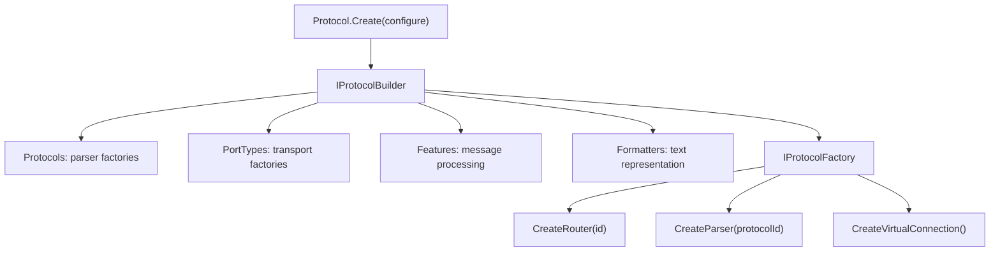
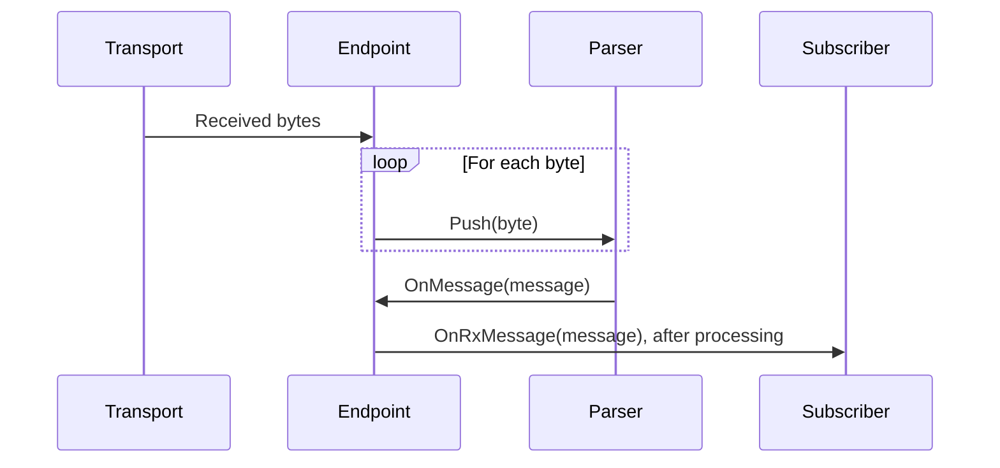

# Protocols

The protocol layer constructs connections and decoders from an explicit configuration. `Protocol.Create(...)` produces an `IProtocolFactory`; that factory can create routers, standalone parsers, and virtual connections.

## Core Contracts



| Contract | Responsibility |
| --- | --- |
| `IProtocolBuilder` | Registers protocol parsers, port types, features, formatters, logging, metrics, and time services. |
| `IProtocolFactory` | Exposes available registrations and creates configured protocol objects. |
| `IProtocolContext` | Supplies shared configuration to connection and parser implementations. |
| `IProtocolParser` | Consumes bytes through `Push`, publishes decoded messages and parsing errors, and supports `Reset`. |
| `ProtocolInfo` | Carries a protocol ID and display name. |

The current builder registers the standard transport types and simple formatter by default. It does not select an application protocol automatically. `ClearAll()` clears the registrations and resets logging, metrics, and time configuration; register everything needed after calling it.

## Configuration

```csharp
using Asv.IO;

var factory = Protocol.Create(builder =>
{
    builder.Protocols.RegisterExampleProtocol();
    builder.Formatters.RegisterJsonFormatter();
    builder.Features.RegisterEndpointIdTagFeature();
});

await using var router = factory.CreateRouter("application");
foreach (var protocol in router.AvailableProtocols)
{
    Console.WriteLine($"{protocol.Id}: {protocol.Name}");
}
```

Production protocol packages provide their own registration extensions. The application selects those packages; the shared transport and inspection code can continue to use `IProtocolMessage`.

## Parsing

A parser receives individual bytes. `OnMessage` publishes a recognized message; `OnError` publishes parsing failures. `Push` returns a boolean recognition result rather than the decoded object.



An endpoint can run several registered parsers over incoming data. In the current endpoint read loop, a successful parser result resets the parser set. Do not assume that every parser sees one independently framed stream or that every input byte produces a message.

## Ownership And Diagnostics

Dispose standalone parsers, routers, and virtual connections when their owner finishes. A router owns its ports; ports own their endpoints. Keep subscriber lifetimes explicit as well.

The current `VirtualConnection` forwards stream completion between its two sides. Disposing it can report an `ObjectDisposedException` through R3's unhandled-exception handler when the opposite subject has already been disposed. This cleanup limitation is separate from message decoding; do not interpret a successful round trip as proof that disposal is free of diagnostics.

Use the configured `TimeProvider`, logger factory, and meter factory when implementing protocol components. This keeps timing and diagnostics consistent and permits deterministic tests.

## Source Files

- `src/Asv.IO/Protocol/Protocol.cs` and `IProtocolBuilder.cs`.
- `src/Asv.IO/Protocol/Parser/IProtocolParser.cs` and `ProtocolParser.cs`.
- `src/Asv.IO/Example/Protocol/ExampleProtocol.cs`.

See [Connections](IO-Connections.md) for transport composition and [Features and formatters](IO-Features.md) for message processing.
