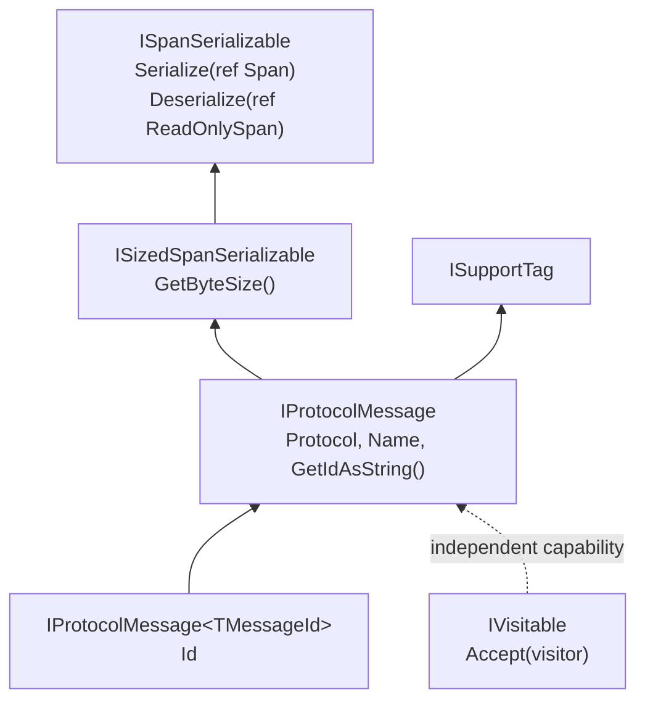

# Serialization

Binary serialization and structured field traversal are separate capabilities. A message can implement serialization without exposing fields to a visitor; a visitable object need not be a protocol message.

## Core Contracts



| Contract | Guarantee |
| --- | --- |
| `ISpanSerializable` | Can write to and read from spans passed by reference. |
| `ISizedSpanSerializable` | Reports the byte size required for the serialized representation. |
| `IProtocolMessage` | Adds protocol identity, message name, string-form ID, and tags. |
| `IProtocolMessage<TMessageId>` | Exposes the protocol-specific typed message ID. |

The span is passed by reference so implementations can advance it as they consume bytes. When implementing a complete message, keep `GetByteSize`, the number of bytes written, and the bytes consumed on reading consistent.

## Encoding An Outbound Stream

`IProtocolEncoder` is the boundary between a message's serialized representation and the bytes sent on one outbound stream. It supports protocols whose framing depends on previous words or whose final frame can be shorter than the reserved capacity:

```csharp
public interface IProtocolEncoder
{
    int GetMaxByteSize(IProtocolMessage message);
    int Encode(IProtocolMessage message, Span<byte> destination);
}
```

`GetMaxByteSize` returns a nonnegative upper bound without advancing state or serializing the message. `Encode` writes to the start of the destination and returns the actual byte count. A destination at least as large as that bound must be sufficient. The owner sends only `destination[..written]` and calls `Encode` once for each frame.

A stateful implementation validates capacity and message data before committing its new state. If encoding fails, the previous state must remain intact; the destination contents are unspecified. Successful encoding advances state exactly once. Keep this state in the encoder, independently of message objects and receive parsers. Encoder instances are not required to be thread-safe.

`DefaultProtocolEncoder` adapts existing messages: it reserves `GetByteSize()` bytes, calls `Serialize` once, and counts the bytes consumed from the span. No encoder registration is required for existing protocols. The existing `ISizedSpanSerializable` contract has not been redefined as a general maximum-size contract.

The canonical message serialization remains available for operations such as hashing, `CopyTo`, and `BinaryClone`. Those operations do not use a stream encoder or advance its state. Existing strict `Serialize()` helpers retain their size checks and behavior. For output that may vary in size or depend on stream state, use the explicit encoder helpers:

```csharp
IProtocolEncoder encoder = DefaultProtocolEncoder.Instance;

byte[] frame = message.EncodeToArray(encoder);
int streamBytes = message.EncodeToStream(stream, encoder);
int asyncBytes = await message.EncodeToStreamAsync(stream, encoder, cancel);
int writerBytes = message.EncodeTo(bufferWriter, encoder);
bool sent = await dataStream.Send(message, encoder, cancel);
```

These are alternative output operations; each invocation encodes a new frame. `EncodeToArray` returns an array containing only the encoded bytes. Stream helpers write the actual byte count, and the `IBufferWriter<byte>` helper advances the writer by that count. Asynchronous stream and `IDataStream` helpers retain rented memory until the write or send task completes, following the [.NET memory ownership guidelines](https://learn.microsoft.com/en-us/dotnet/standard/memory-and-spans/memory-t-usage-guidelines).

The `IDataStream.Send(message, encoder, cancel)` overload requires the cancellation token argument; use `CancellationToken.None` when cancellation is unnecessary. This preserves the meaning of existing calls such as `dataStream.Send(message, default)`, where `default` remains a cancellation token. A `false` result from `IDataStream.Send` is a failed send and needs the same recovery decision as an exception.

The caller owns the encoder passed to these helpers and must order the entire encode-and-send operation for a stateful stream. The helpers do not add synchronization, reset state, or retry failed sends. A failed write may have delivered part of a frame; continuing or retrying requires protocol-specific recovery. Create a new encoder for a new stream.

## Round Trip

```csharp
using Asv.IO;

var original = new ExampleMessage2
{
    SenderId = 2,
    Value1 = 123,
    Value3 = "Sample",
    Value5 = 24.5f,
};

var bytes = new byte[original.GetByteSize()];
Span<byte> output = bytes;
original.Serialize(ref output);

var decoded = new ExampleMessage2();
ReadOnlySpan<byte> input = bytes;
decoded.Deserialize(ref input);

Console.WriteLine(decoded.Value5);
```

This example knows the concrete type. For an unknown byte stream, use the protocol's parser to recognize framing and select the appropriate message type instead of guessing from the payload.

## Lengths And Partial Input

Treat lengths read from a stream as input to validate before allocating or resizing collections. The simple binary visitor checks a list's count against its existing `ListType.MinSize` and `MaxSize`, as well as the collection's `Int32` capacity, before changing the destination list. `ExampleMessage1` likewise enforces the bounds declared by its list fields. These checks preserve each schema's limits; there is no new global list limit.

`BinSerialize` string prefixes describe the number of UTF-8 bytes, including when calculating the space needed for a multibyte string. The existing `string` write and size overloads normalize `null`, empty, and whitespace-only strings to an empty encoded string; the `ReadOnlySpan<char>` overloads preserve whitespace. Use an explicit byte limit when the surrounding protocol defines one:

```csharp
string text = BinSerialize.ReadString(stream, maxByteCount: 64 * 1024);

string value = string.Empty;
bool complete = BinSerialize.TryReadString(
    ref reader,
    ref value,
    maxByteCount: 64 * 1024);
```

Here `reader` is a `SequenceReader<byte>`. An oversized declared length throws `InvalidDataException`. Incomplete sequence input returns `false`, leaves the reader and destination value unchanged, and does not rent a payload buffer. Complete contiguous input is decoded directly; segmented input is copied only after checking that the whole payload is available.

The stream reader checks the remaining length of seekable streams before renting. It reads byte input in chunks of at most 4 KiB, including for non-seekable streams, and preserves UTF-8 decoder state across chunk boundaries. Larger strings also use a pooled character buffer and a growing `StringBuilder`; the accumulated text and resulting string require memory proportional to the text actually read. Existing stream and sequence overloads retain their `Int32.MaxValue` default limit; the string-returning span and memory overloads retain their existing requirement that encoded text be smaller than 128 KiB.

The `Deserialize(ref ReadOnlySequence<byte>)` helper takes the expected input length from the destination object's current `GetByteSize()`. On success, it advances the sequence by that length and leaves subsequent data available. If there are fewer than that many bytes, it returns `false` without advancing the sequence. It does not discover a variable-length frame or derive its size from an incoming header; use a protocol parser when the expected size is not already known.

General mutable deserializers do not promise rollback after an exception. In particular, `SpanArrayType<T>` clears its previous items after reading the count prefix, including when the new count is zero. It has no `ListType` schema limits; a truncated payload can leave the successfully decoded new items in the same collection.

## Buffer And Object Ownership

The integer and unmanaged-struct reservation helpers validate destination capacity before clearing the reserved bytes or returning a writable reference. An insufficient span is rejected without modifying its backing storage.

`ExampleParser` owns its rented frame buffer, sized for the full 255-byte payload plus five framing bytes. Either disposal path returns it once, and subsequent `Push` or `Reset` calls fail with `ObjectDisposedException`. Dispose parsers only after their input producer has stopped using them; physical endpoints coordinate this ordering.

`StreamBitWriter` disposes its owned stream even if flushing buffered bits fails. The `leaveOpen` option retains caller ownership through both synchronous and asynchronous disposal.

`ProtocolTags.RemoveAt` and `Clear` release references to removed values, including values previously stored inline before the collection grew. Overflow capacity can remain available for reuse without retaining those removed payloads. The public enumerator contract is unchanged.

## Protocol-Specific Rules

The common contracts do not define endianness, checksums, length encoding, optional fields, or packet headers. Those belong to each protocol's serializer, encoder, and parser. A buffer that is large enough does not make an otherwise invalid packet valid.

For example, MAVLink 2 removes trailing zero bytes from its payload while retaining at least its first byte. Its packet length, CRC, and optional signature belong to MAVLink framing; a generic encoder must not trim zeros from the completed frame. Existing MAVLink serializers that already perform this step work with `DefaultProtocolEncoder` because it respects the consumed span length. See the [MAVLink payload truncation rules](https://mavlink.io/en/guide/serialization.html#payload_truncation).

RTCM2 can use a custom encoder for previous-word parity state and transport packing while retaining a canonical message representation. The abstraction added in `Asv.IO` does not implement RTCM2 parity or packing; that protocol-specific implementation belongs in `asv-gnss`.

Use binary helpers such as `BinSerialize` where they match the wire format. The visitor-based simple binary helpers are a separate facility; do not substitute them for a protocol serializer merely because both operate on the same field values.

## Captures And Snapshots

For a decoded-history view, copy field values at observation time. For a wire capture, record the actual transport bytes and the relevant framing context. Serialization of the current object cannot reconstruct malformed input discarded by a parser.

Array and nested-object properties can be mutable even when their containing message reference does not change. A history buffer that stores the original object therefore does not guarantee a stable snapshot.

## Source Files

- `src/Asv.IO/Serializable/ByteBased/ISpanSerializable.cs`.
- `src/Asv.IO/Serializable/ByteBased/ISizedSpanSerializable.cs`.
- `src/Asv.IO/Serializable/ByteBased/BinSerialize/BinSerialize.String.cs`.
- `src/Asv.IO/Serializable/ByteBased/SpanSerializableMixin.cs` and `CommonSerializableTypes/SpanArrayType.cs`.
- `src/Asv.IO/Serializable/BitBased/Writer/StreamBitWriter.cs`.
- `src/Asv.IO/Visitable/Visitors/BinarySerializer/SimpleBinaryDeserialize.cs`.
- `src/Asv.IO/Protocol/Message/IProtocolMessage.cs`.
- `src/Asv.IO/Protocol/Tag/ProtocolTags.cs`.
- `src/Asv.IO/Protocol/Encoder/IProtocolEncoder.cs` and `ProtocolEncodingMixin.cs`.
- `src/Asv.IO/Streams/IDataStream.cs`.
- `src/Asv.IO/Example/Protocol/ExampleMessageBase.cs` and `ExampleParser.cs`.

See [Fields and visitors](IO-Visitors.md) for inspecting values and [Protocols](IO-Protocols.md) for stream decoding.
