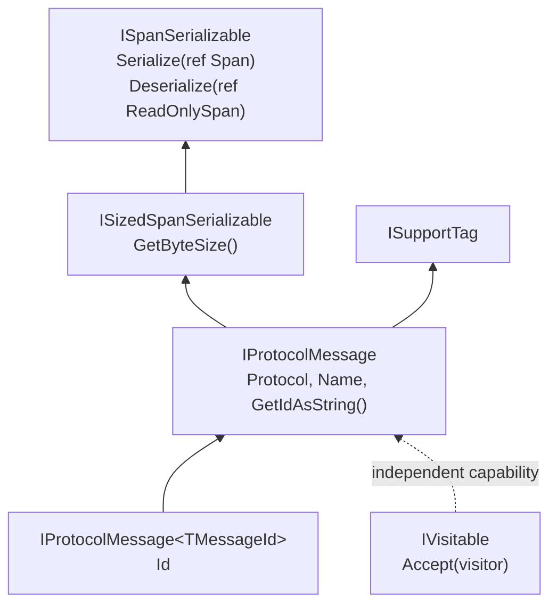

# Serialization

Binary serialization and structured field traversal are separate capabilities. A message can implement serialization without exposing fields to a visitor; a visitable object need not be a protocol message.

## Core Contracts



| Contract | Guarantee |
| --- | --- |
| `ISpanSerializable` | Can write to and read from spans passed by reference. |
| `ISizedSpanSerializable` | Reports the byte size required for the serialized representation. |
| `IProtocolMessage` | Adds protocol identity, message name, string-form ID, and tags. |
| `IProtocolMessage<TMessageId>` | Exposes the protocol-specific typed message ID. |

The span is passed by reference so implementations can advance it as they consume bytes. When implementing a complete message, keep `GetByteSize`, the number of bytes written, and the bytes consumed on reading consistent.

## Round Trip

```csharp
using Asv.IO;

var original = new ExampleMessage2
{
    SenderId = 2,
    Value1 = 123,
    Value3 = "Sample",
    Value5 = 24.5f,
};

var bytes = new byte[original.GetByteSize()];
Span<byte> output = bytes;
original.Serialize(ref output);

var decoded = new ExampleMessage2();
ReadOnlySpan<byte> input = bytes;
decoded.Deserialize(ref input);

Console.WriteLine(decoded.Value5);
```

This example knows the concrete type. For an unknown byte stream, use the protocol's parser to recognize framing and select the appropriate message type instead of guessing from the payload.

## Protocol-Specific Rules

The common contracts do not define endianness, checksums, length encoding, optional fields, or packet headers. Those belong to each protocol's serializer and parser. A buffer that is large enough does not make an otherwise invalid packet valid.

Use binary helpers such as `BinSerialize` where they match the wire format. The visitor-based simple binary helpers are a separate facility; do not substitute them for a protocol serializer merely because both operate on the same field values.

## Captures And Snapshots

For a decoded-history view, copy field values at observation time. For a wire capture, record the actual transport bytes and the relevant framing context. Serialization of the current object cannot reconstruct malformed input discarded by a parser.

Array and nested-object properties can be mutable even when their containing message reference does not change. A history buffer that stores the original object therefore does not guarantee a stable snapshot.

## Source Files

- `src/Asv.IO/Serializable/ByteBased/ISpanSerializable.cs`.
- `src/Asv.IO/Serializable/ByteBased/ISizedSpanSerializable.cs`.
- `src/Asv.IO/Protocol/Message/IProtocolMessage.cs`.
- `src/Asv.IO/Example/Protocol/ExampleMessageBase.cs` and `ExampleParser.cs`.

See [Fields and visitors](IO-Visitors.md) for inspecting values and [Protocols](IO-Protocols.md) for stream decoding.
