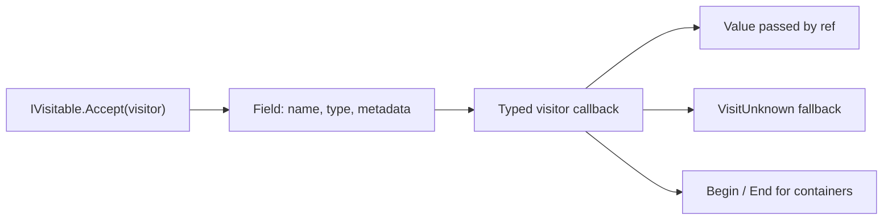
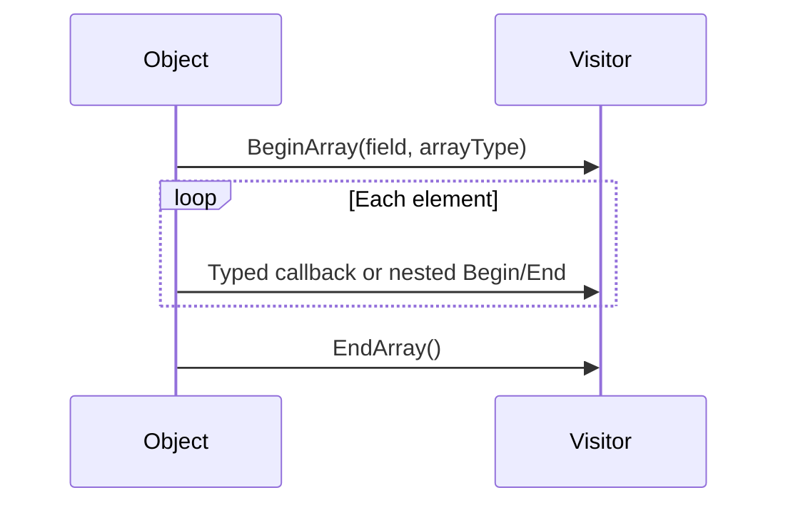

# Fields And Visitors

The visitor layer exposes structured fields without requiring reflection over every concrete message class. It supports readers such as inspectors and formatters, as well as writers such as deserializers and value generators.

## Core Contracts



| Contract | Responsibility |
| --- | --- |
| `IVisitable` | Exposes `Accept(IVisitor)`. |
| `IVisitor` | Provides the `VisitUnknown(Field, IFieldType)` fallback. |
| `IReferenceVisitor<TType, TValue>` | Receives a typed field and its value by reference. |
| `IFieldType` | Describes a field's type. |
| `Field` | Combines the canonical field name, type, and metadata. |
| `IFullVisitor` / `FullVisitorBase` | Covers the supported scalar, optional, and container callbacks. |

`IVisitor` alone does not receive every value: a visitor implements the corresponding typed interfaces to receive those values. Otherwise the field dispatches to `VisitUnknown`.

## Field Metadata

A field builder can provide `Title`, `Description`, `Units`, `FormatString`, and enum metadata. These are optional hints. Keep the canonical field name and raw value available even when a UI presents a friendly title, unit, or symbolic value.

```csharp
using Asv.IO;

var field = Field.CreateBuilder()
    .Name("temperature")
    .DataType(FloatType.Default)
    .Title("Temperature")
    .Description("Measured sensor temperature")
    .Units("degC")
    .FormatString("0.00")
    .Build();

Console.WriteLine($"{field.Name}: {field.GetUnits()}");
```

## Reading Values

```csharp
using Asv.IO;

var message = new ExampleMessage2
{
    Value1 = 42,
    Value3 = "Sensor A",
    Value5 = 12.5f,
};
Console.WriteLine(message.PrintValues());
```

`PrintValueVisitor` is a useful example of typed value callbacks. `FieldVisitor` and `VisitFields` focus on field descriptions; they do not provide a full indexed value snapshot of all container elements.

A read-only visitor must copy or format the value without assigning to the supplied `ref`. For asynchronous UI updates, build an independent snapshot before crossing to the UI thread.

## Containers And Optional Values



Maintain a stack of container frames when building a field tree. Arrays and lists need element indices, while structures need their member names. Keep the callback's type in the frame: a structure inside an array may reuse the array's `Field` descriptor while passing its own `StructType`.

Optional scalar values are nullable. Optional structures report presence and a `createNew` result; an inspecting visitor must return `false`, because returning `true` replaces even an existing structure with a new instance. A read-only list visitor must likewise preserve the `size` passed by reference to `BeginList`, because changing it resizes the source list before visiting its elements. Distinguish a missing value, an empty container, an unsupported field type, and a numeric zero.

## Protocol Independence

`IProtocolMessage` does not inherit `IVisitable`. A protocol may expose a visitable message, a separate visitable payload, or no structured field access. The protocol integration should supply that visitable object; the generic inspector should not assume a particular payload property or device addressing format.

Visitor callbacks do not guarantee offsets into the original packet. Linking a field to selected HEX bytes requires additional wire-layout information.

## Source Files

- `src/Asv.IO/Visitable/IVisitor.cs` and `IVisitable.cs`.
- `src/Asv.IO/Visitable/Field` and `Types`.
- `src/Asv.IO/Visitable/Visitors/PrintValueVisitor.cs`, `FieldVisitor.cs`, and `FullVisitorBase.cs`.
- `src/Asv.IO.Test/Visitable`.

See [Serialization](IO-Serialization.md) for binary contracts and [Devices](IO-Devices.md) for device identification.
