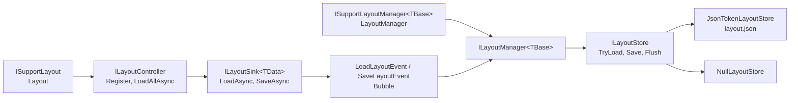
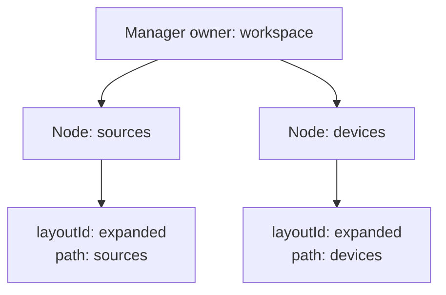
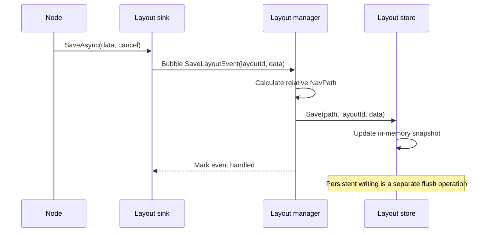
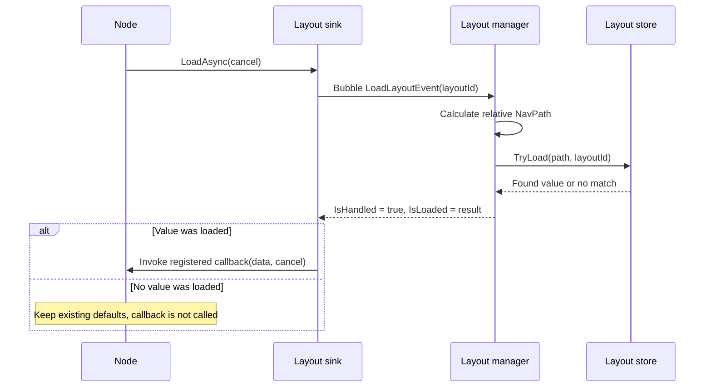

# Layout

The layout layer saves and restores model state by navigation path and a local layout identifier. Typical values include panel widths, expanded sections, selected views, and filter settings. It is independent of visual layout measurement: `Asv.Modeling` does not arrange controls or know about Avalonia panels.

A node registers the values it can restore. A manager attached to a tree root catches routed load/save events and forwards them to a store. This separates local state handling from persistence and follows the same [tree](Tree.md), [routed event](RoutedEvents.md), and [navigation](Navigation.md) contracts as the other modeling features.

## Core Types



| Type | Responsibility |
| --- | --- |
| `ISupportLayout` | Exposes the node's layout controller. |
| `ILayoutController` | Registers typed values and explicitly loads all registrations on that controller. |
| `ILayoutSink<TData>` | Loads or saves one registered value; disposal unregisters it. |
| `LoadLayoutCallback<TData>` | Applies a loaded value and receives a cancellation token. |
| `LoadLayoutEvent<TBase, TData>` | Requests a value through a bubble event and reports whether it was loaded. |
| `SaveLayoutEvent<TBase, TData>` | Publishes a typed value through a bubble event. |
| `ISupportLayoutManager<TBase>` | Exposes the manager responsible for a tree's layout state. |
| `ILayoutManager<TBase>` | Connects the tree's events to a store. |
| `ILayoutStore` | Stores values by `NavPath` and layout ID and flushes pending changes. |

`LayoutController<TBase>` requires an owner that supports routed events and `INotifyPropertyChanged`. The controller does not infer properties from notifications: the application still registers load callbacks and decides when to save.

## Stable Storage Identity

Every value is addressed by two parts:

- The sender's navigation path relative to the manager's owner, excluding the manager owner's own ID.
- The `layoutId` supplied to `Register`, unique within that controller.



Both nodes can register `expanded` because their paths differ. A registration on the manager owner itself uses an empty relative path. A manager must be an ancestor of the sender for path calculation to succeed.

Use stable node IDs and arguments when state should survive reopening a page. Renaming a node, changing its navigation arguments, or changing a layout ID changes the storage address. Reparenting a node can change the address as well.

## Registration Is Explicit

Registering a value creates a sink; it does not load the value immediately. Duplicate layout IDs on the same controller are rejected. Dispose a registration before replacing it with another registration using the same ID.

```csharp
using Asv.Modeling;

static async ValueTask SaveAndRestoreWidthAsync(
    ILayoutController layout,
    CancellationToken cancel)
{
    double width = 240;
    using var registration = layout.Register<double>("width", value => width = value);

    await registration.LoadAsync(cancel);
    Console.WriteLine(width); // Restored value, or 240 if nothing was stored.

    width = 360;
    await registration.SaveAsync(width, cancel);
}
```

The synchronous `Action<TData>` callback overload is a convenience wrapper. Use the `LoadLayoutCallback<TData>` overload when applying a value requires asynchronous work.

`LoadAllAsync` loads registrations belonging to that controller, sequentially from a snapshot of its registration collection. It does not walk child nodes. Each participating child needs its own load call or root-attachment subscription.

## Save Flow



The manager ignores events already marked handled. A handled save means the store accepted the value; it does not guarantee that a file was written. `SaveAsync` rejects null data. Errors from the callback/event/store path can propagate to the caller.

## Load Flow



`IsHandled` and `IsLoaded` have different meanings. A manager can handle the request without finding saved data. Reading `LayoutData` before a successful load throws. If no manager handles the request, the registration also has no loaded value to apply.

## Save On A Trigger

The trigger overload combines a registration with an R3 subscription. On each trigger, it obtains the current value and saves it. A null result is skipped for types that can represent null.

```csharp
using Asv.Modeling;
using R3;

static IDisposable RegisterWidth(
    ILayoutController layout,
    Action<double> applyWidth,
    Func<double> readWidth,
    Observable<double> widthChanged)
{
    return layout.Register<double, double>(
        "width", applyWidth, readWidth, widthChanged);
}
```

The trigger's payload does not become the stored value automatically: the `save` function supplies that value. The returned disposable owns both the registration and the trigger subscription. Registration still does not initiate loading.

Choose a save trigger that reflects a meaningful change. If applying a loaded value raises that same trigger, prevent an unwanted save feedback loop in the application. The layout helper does not suppress publication during loading, and it does not record [undo](Undo.md) changes by itself.

## Load When Attached To A Root

Register values before requesting automatic root-based loading. Root tracking provides the point at which the node has a usable parent chain and can reach the manager.

```csharp
using Asv.Modeling;

static IDisposable RestoreWhenAttached<TRoot>(
    ILayoutController layout,
    IRootTrackingController<TRoot> rootTracking,
    CancellationToken cancel)
{
    return layout.LoadWhenRootAttached(rootTracking, cancel);
}
```

`LoadWhenRootAttached` requests `LoadAllAsync` immediately if a root is already attached, and again on later root attachments. It does not create a manager or a store. When the supplied cancellation token is cancellable, the helper passes it to loading; otherwise it uses the callback token supplied by root tracking.

Dispose the returned subscription with the node. Ensure the manager exists before attachment triggers the first load. Do not assume callbacks run on a UI dispatcher: loading uses asynchronous routed events and `ConfigureAwait(false)`, and the application must marshal UI-bound updates where needed.

## Persistence Stores

`NullLayoutStore.Instance` ignores saves, never returns loaded data, and makes `Flush` and disposal no-ops. It is useful when persistence is intentionally disabled.

`JsonTokenLayoutStore` keeps serialized `JToken` snapshots in memory and writes one human-readable `layout.json` file under the supplied storage directory.

```csharp
using Asv.Modeling;

var directory = Path.Combine(Path.GetTempPath(), "asv-layout-" + Guid.NewGuid().ToString("N"));
using var store = new JsonTokenLayoutStore(directory);
var path = NavPath.Parse("workspace/sources");

store.Save(path, "expanded", true);
store.Flush();
if (store.TryLoad<bool>(path, "expanded", out var expanded))
{
    Console.WriteLine(expanded);
}
```

This example addresses the store directly. When using a manager, it computes the path relative to its own root instead.

The JSON store:

- Loads existing snapshots when constructed.
- Stores `Path`, `LayoutId`, and `Data` for each entry and writes them as an indented array, ordered by path and layout ID.
- Accepts the legacy dictionary representation when loading.
- Updates the in-memory snapshot and dirty flag on `Save`.
- Flushes automatically every five seconds by default; the constructor accepts a different interval and `TimeProvider`.
- Flushes pending changes during `Dispose`, or explicitly through `Flush`.
- Writes through a temporary file and replaces `layout.json` after writing.
- Logs and skips invalid files or values; a failed load leaves the node's defaults available.

The JSON store uses a hash of the path and layout ID for its internal lookup key. Snapshot metadata is checked during loading. Do not depend on an internal hash as an application's navigation identifier.

Use small serializable data objects or scalar values. A changed data shape may no longer deserialize; validate restored values in the callback before applying them. Explicit `Flush` and disposal can propagate write errors; the timer logs flush errors.

## Ownership And Integration

`LayoutManager<TBase>` takes ownership of its store and disposes it with the manager. Give the manager a store whose lifetime matches that ownership; do not dispose a shared store while other managers still use it.

A node owns its controller, its registration sinks, and any trigger or root-attachment subscriptions. Disposing the controller unregisters its remaining entries. Dispose trigger subscriptions too: removing an entry alone does not stop an unrelated observable from producing values.

To add layout persistence to a model tree:

1. Provide routed events and stable navigation IDs on the participating nodes.
2. Create the manager at the root with the chosen store.
3. Create each node's controller and register its values.
4. Attach nodes with correct parent references.
5. Load each controller explicitly, or subscribe through root tracking.
6. Save on application-defined changes and flush at the required persistence boundary.

## Source Files And Tests

- `src/Asv.Modeling/Layout/Controller` contains registrations, sinks, and helper overloads.
- `src/Asv.Modeling/Layout/Events` contains the bubble load/save events.
- `src/Asv.Modeling/Layout/Manager` contains the tree manager and stores.
- `src/Asv.Modeling.Test/Layout/ISupportLayoutTest.cs` covers path-based restoration, missing values, JSON output, explicit and timed flushing, and loading after root attachment.
